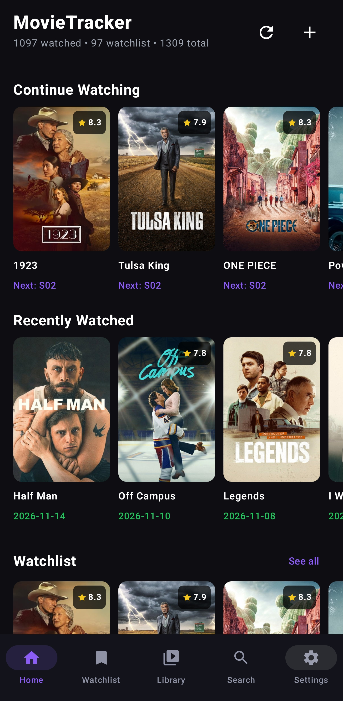
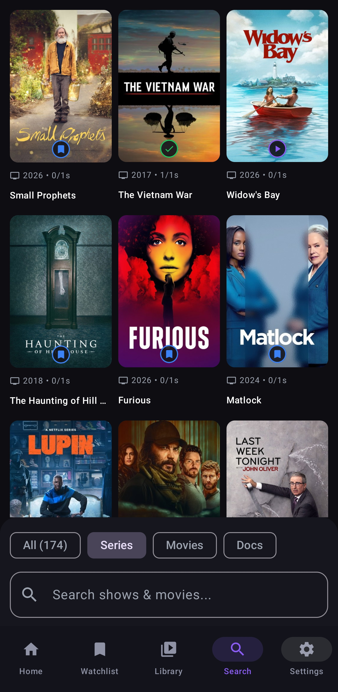
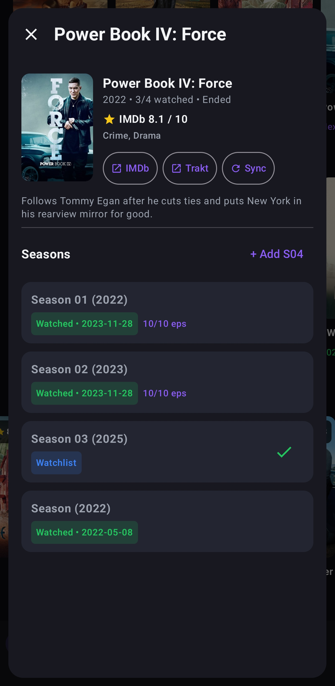
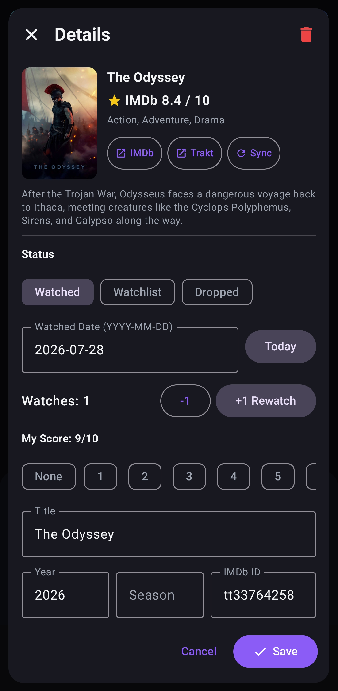

# 🎬 MovieTracker

-3DDC84?logo=android&logoColor=white)

> **Personal offline-first Android app for tracking watched movies, TV series by season, and watchlist — with Trakt.tv 1-way sync, TMDB/OMDb enrichment, and a clean Trakt-inspired dark UI.**

[🇬🇧 English](#english) • [🇻🇳 Tiếng Việt](#tiếng-việt)

---

## 📸 Screenshots

> *Screenshots from Samsung Galaxy S25 Ultra (Dark Theme)*

| Home & Continue Watching | 3-Column Poster Grid (Search) | Series Season Tracker | Details (IMDb & Trakt) |
| :---: | :---: | :---: | :---: |
|  |  |  |  |

---

## 🇬🇧 English

### ✨ Features
- **Offline-First SQLite Library:** Instant search across titles, IMDb IDs (`tt...`), genres, release years, and personal notes without needing an internet connection.
- **Trakt-Inspired Dark UI (5-Tab Navigation):**
  - **Home:** *Continue Watching* carousel (in-progress series and shows with newly released watchlist seasons), *Recently Watched*, and *Watchlist* picks.
  - **Watchlist & Library:** Filter by status (`Watched`, `Watchlist`, `Dropped`) and type (`Movie`, `Series`, `Documentary`), switch between **3-Column Poster Grid** and **Detailed List**, and sort **Ascending (`↑`) / Descending (`↓`)** by Updated, Watched Date, IMDb Rating, My Score, Year, or Title.
  - **Search:** Full-screen 3-column poster grid with status badges (`✓` Watched, `▶` Watching, Bookmark Watchlist, `✕` Dropped), bottom-anchored search bar, and quick online TMDB/IMDb lookup.
  - **Settings:** Centralized API setup, sync tools, CSV/JSON import-export, and backup controls.
- **Grouped Series Tracking:** Automatically groups seasons (`S01`, `S02`, ...) under a single show with progress bars, quick mark-watched actions, `+ Add Season`, and TMDB season sync.
- **Trakt.tv 1-Way Sync (PKCE / Device Code Flow):**
  - Free-tier friendly: pulls watched movies, season/episode progress (`Watching: 5/12 eps`), watchlist, and ratings without modifying your Trakt account.
  - Connects using only **Client ID** (supports Trakt's secret-less PKCE apps).
  - Optional automatic background sync every 3 hours on app launch.
- **Auto-Check New Seasons (TMDB):** Runs daily in the background (or manually), automatically adding newly aired seasons to your Watchlist while skipping `Dropped` and `Ended`/`Canceled` series.
- **OMDb & TMDB Enrichment:** Fetches IMDb ratings, genres, plots, and caches posters locally on the device; includes a 100-entry batch fetcher.
- **Android Share Sheet Support:** Share any IMDb link or title from Chrome or the IMDb app directly to MovieTracker to check watch history or add to your watchlist.
- **Backup & Google Drive Export:** Auto-backup JSON to a selected folder after every change, 1-tap `Send to Drive`, manual JSON backup/restore, and CSV export.

### 🛠 Tech Stack
- **Language & UI:** Kotlin, Jetpack Compose (Material 3)
- **Local Storage:** SQLite (`SQLiteOpenHelper`) + local poster file cache
- **Networking:** Built-in `HttpURLConnection` + `org.json` (zero heavy third-party dependencies)
- **CI/CD:** GitHub Actions (`gradle assembleDebug`)

### 🔑 Free API Setup (Optional for Online Features)
1. **OMDb API Key** *(IMDb ratings, genres, plot)*: Get a free key (1,000 req/day) at [omdbapi.com/apikey.aspx](https://www.omdbapi.com/apikey.aspx) and activate it via email.
2. **TMDB API Key** *(posters, search, new season tracking)*: Create an account at [themoviedb.org](https://www.themoviedb.org/settings/api) and copy your API Key or Read Access Token.
3. **Trakt Client ID** *(1-way sync)*: Create an app at [trakt.tv/oauth/applications/new](https://trakt.tv/oauth/applications/new) with Redirect URI `urn:ietf:wg:oauth:2.0:oob`. Paste only the **Client ID** into Settings and leave Client Secret blank.

### 📊 Google Sheets CSV Import Format
The built-in CSV importer supports spreadsheets with columns:
`Title, Type, Release, IMDB link, Watched date, [Extra/Rewatch e.g. x3]`
- **Date present:** Imported as `Watched` (normalizes formats like `2-Dec-2024`, `01/04/2026`).
- **Empty date:** Imported as `Watchlist`.
- **`x`:** Imported as `Dropped`.
- **Series seasons:** Titles formatted as `Show Name - S01` are automatically grouped under `Show Name`.

### 🚀 Build APK via GitHub Actions
1. Push or edit files on `main` (or trigger manually from the **Actions** tab).
2. Open the latest green **Build Android APK** workflow run.
3. Download **`MovieTracker-APK`** under **Artifacts**, unzip, and install `app-debug.apk` on your Android device (Android 7.0+ / API 24+).

---

## 🇻🇳 Tiếng Việt

### ✨ Tính năng chính
- **Kho phim Offline siêu nhanh (SQLite):** Tìm kiếm tức thì theo tên phim, mã IMDb (`tt...`), thể loại, năm phát hành và ghi chú cá nhân mà không cần mạng.
- **Giao diện tối chuẩn Trakt (5 tab dưới cùng):**
  - **Home:** Hàng cuộn *Continue Watching* (gom các Series đang xem dở và Series có mùa mới trong Watchlist), *Recently Watched* và *Watchlist*.
  - **Watchlist & Library:** Lọc theo trạng thái (`Watched`, `Watchlist`, `Dropped`) và thể loại (`Movie`, `Series`, `Documentary`); chuyển đổi giữa **Lưới Poster 3 cột** và **Danh sách chi tiết**; đảo chiều sắp xếp **Tăng dần (`↑`) / Giảm dần (`↓`)**.
  - **Search:** Toàn màn hình là lưới poster 3 cột kèm huy hiệu trạng thái (`✓` Đã xem, `▶` Đang xem, Bookmark Watchlist, `✕` Bỏ dở), thanh tìm kiếm nằm dưới đáy thuận tiện dùng một tay, hỗ trợ tìm và thêm phim online ngay khi không có trong kho.
  - **Settings:** Màn hình cài đặt API, đồng bộ, nhập/xuất dữ liệu và sao lưu.
- **Quản lý Series theo nhóm mùa:** Tự động gộp `S01, S02...` về cùng một bộ phim với thanh tiến độ, đánh dấu nhanh từng mùa, thêm mùa mới và đồng bộ danh sách mùa từ TMDB.
- **Đồng bộ 1 chiều từ Trakt.tv (hỗ trợ tài khoản Free & PKCE):**
  - Kéo lịch sử phim đã xem, tiến độ xem dở từng mùa (`Watching: 5/12 eps`), Watchlist và điểm cá nhân về app mà không ghi đè dữ liệu trên Trakt.
  - Đăng nhập qua mã thiết bị (`trakt.tv/activate`), **chỉ cần Client ID** (không cần Client Secret).
  - Hỗ trợ tự động đồng bộ ngầm mỗi 3 tiếng khi mở app.
- **Tự động kiểm tra mùa mới (TMDB):** Quét mỗi ngày 1 lần (hoặc bấm tay) để tự thêm các mùa mới đã phát sóng vào Watchlist, đồng thời bỏ qua các bộ đã `Dropped` hoặc đã kết thúc (`Ended`/`Canceled`).
- **Tích hợp OMDb & TMDB:** Tự động tải điểm IMDb, thể loại, tóm tắt, lưu đệm Poster offline và tải bù hàng loạt 100 phim/lượt.
- **Chia sẻ trực tiếp (Android Share Sheet):** Bấm *Share* từ Chrome hoặc app IMDb sang MovieTracker để kiểm tra nhanh đã xem chưa hoặc thêm vào Watchlist.
- **Sao lưu & Google Drive:** Tự động ghi file `MovieTracker_AutoBackup.json` vào thư mục đã chọn sau mỗi thay đổi, gửi nhanh lên Google Drive với 1 chạm (`Send to Drive`), sao lưu/khôi phục JSON và xuất CSV.

### 🔑 Thiết lập API miễn phí
1. **OMDb API Key:** Đăng ký miễn phí (1.000 lượt/ngày) tại [omdbapi.com/apikey.aspx](https://www.omdbapi.com/apikey.aspx) và bấm link kích hoạt trong email.
2. **TMDB API Key:** Tạo tài khoản miễn phí tại [themoviedb.org](https://www.themoviedb.org/settings/api) để lấy API Key hoặc Read Access Token.
3. **Trakt Client ID:** Tạo app cá nhân tại [trakt.tv/oauth/applications/new](https://trakt.tv/oauth/applications/new) với Redirect URI là `urn:ietf:wg:oauth:2.0:oob`. Chỉ cần dán **Client ID** vào app (để trống Client Secret).

### 🚀 Tự động tạo file `.apk` bằng GitHub Actions
1. Lưu thay đổi lên nhánh `main` (hoặc chạy thủ công trong tab **Actions**).
2. Mở lượt chạy **Build Android APK** có tích xanh mới nhất.
3. Tải **`MovieTracker-APK`** ở mục **Artifacts**, giải nén và cài file `app-debug.apk` lên điện thoại Android (Android 7.0 trở lên).

---

## 🙏 Credits & Attribution
- Movie & TV metadata, posters, and season schedules powered by [TMDB](https://www.themoviedb.org/) and [OMDb API](https://www.omdbapi.com/).
- Watch history, progress, and watchlist sync powered by [Trakt.tv](https://trakt.tv/).
- *This product uses the TMDB API but is not endorsed or certified by TMDB.*
